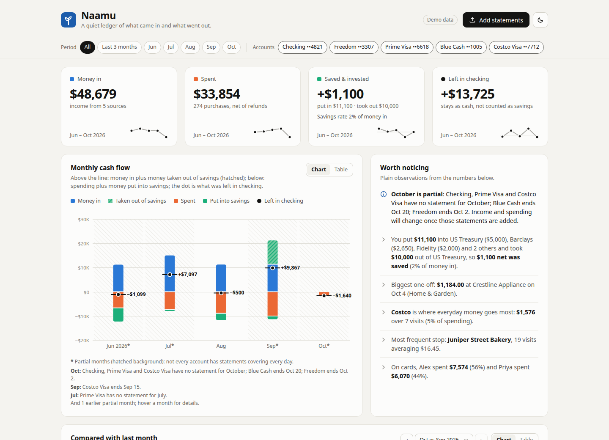
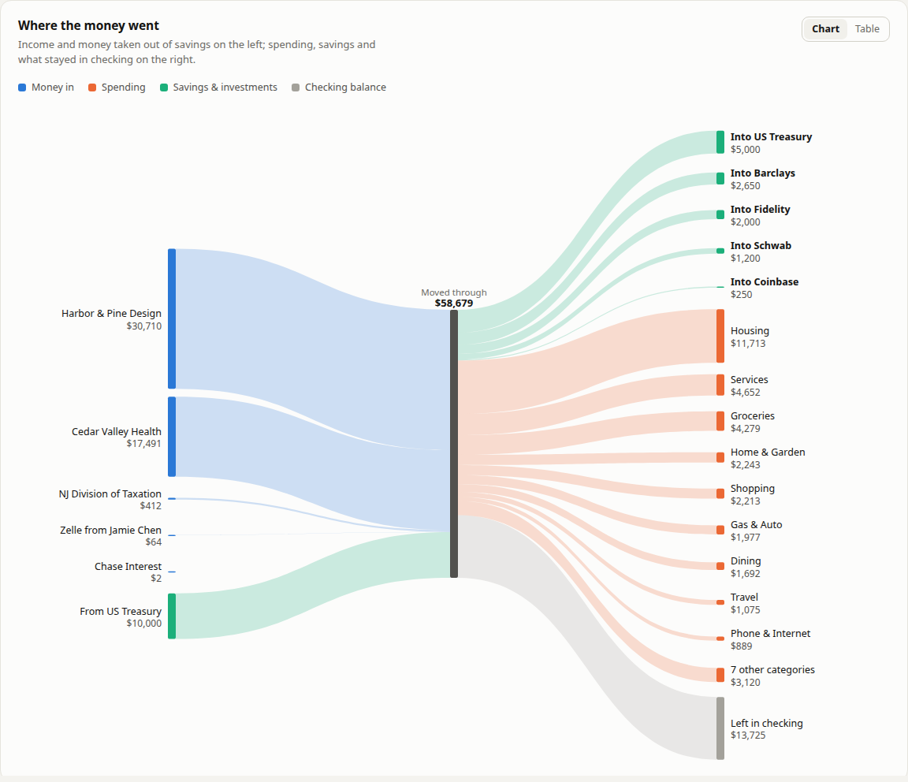

# Naamu

A private, local expense dashboard built from your bank and credit-card statements.
Each month you drop in the statement PDFs; Naamu reads them on your own computer and
shows what came in, what you spent, what you saved, and what was left in checking.



*Screenshots use the built-in fictional demo household.*

- **No AI, no cloud.** Every parser and rule is plain, deterministic code. The server
  listens on `127.0.0.1` only and makes no network calls; the page loads no fonts,
  scripts or charts from the internet.
- **Every statement is verified.** Each parse is checked against the totals printed on the
  statement itself (purchases, payments, deposits, balances) and must match to the cent.
- **No double counting.** A card payment leaving checking is paired with the payment
  received on the card, and both are treated as a transfer — only the purchases count.

## Quick start

Requires Python 3.10+.

```sh
git clone https://github.com/nixit28/naamu.git
cd naamu
./run.sh
```

Open <http://127.0.0.1:8765> and drag your statement PDFs onto the page. The first run
creates `.venv` and installs Flask and pdfplumber; later runs start straight away.

To look around first, open <http://127.0.0.1:8765/?mock> for the demo household
(`?mock&empty` shows the first-run screen). Demo mode never touches your data.

Options: `NAAMU_PORT=9000 ./run.sh` uses another port; `NAAMU_DATA_DIR=/path ./run.sh`
keeps the database and PDFs somewhere else.

## What the dashboard shows

| Section | What it answers |
|---|---|
| Summary tiles | Money in, spent, saved & invested, left in checking — with monthly trend lines |
| Monthly cash flow | Per month: income and money taken out of savings above the line; spending and money put into savings below; a marker for what stayed in checking |
| Compared with last month | Each total and each category against the previous month, plus the biggest merchant changes |
| Where the money went | A flow from each income source (and savings withdrawals) to spending categories, savings destinations and checking |
| Spending by category · Top merchants | Where the money goes; click any bar or merchant to list its transactions |
| Daily spending | A calendar heatmap of spending per day |
| Worth noticing | Plain-English observations: biggest one-off, spending per cardholder, subscriptions per month, refunds |
| Recurring & subscriptions | Charges that repeat month to month, with their monthly cost |
| Accounts & coverage | Which periods each account has statements for, card balances, due dates and credit used, and card payments whose other side hasn't been uploaded |
| Statements | Every uploaded file with a "Totals match" badge showing each check |
| Transactions | Search, filter, change categories, export to CSV |

Every chart has a Table view and hover details, and clicking a month, category,
merchant or day filters the transactions list. Months that aren't fully covered by
every account's statements are marked partial, with the reason spelled out.



## Supported statements

| Institution | Accounts | Status |
|---|---|---|
| Chase | Credit cards (Freedom, Prime Visa, …) | verified against statement totals |
| Chase | Checking and Savings | verified |
| American Express | Credit cards (Blue Cash, …) | verified |
| Citi | Credit cards (Costco Anywhere, …) | verified, including per-cardholder totals |
| Others | Any text-based PDF | best-effort generic reader, shown as **unverified** |

A failed check is flagged in the Statements list, so you always know when to look.

## Monthly workflow

1. Download the month's statement PDFs from each bank.
2. Drag them all onto the dashboard. Order doesn't matter, and re-uploading is safe:
   the same file twice is skipped, and overlapping statements of the same account don't
   double count (each transaction has a fingerprint of account, date, amount,
   description and its position among identical ones).
3. Review anything in **Other** and fix its category — your choice is remembered.
4. Check *Accounts & coverage*: an unmatched card payment usually means a statement you
   haven't uploaded yet.

## How it counts

- **Money in** = income: payroll, tax refunds, interest, other income.
- **Spent** = expenses − refunds.
- **Saved & invested** = money put into your savings and investment destinations, minus
  money taken back out. Out of the box these are **Fidelity, Schwab, E\*Trade, Coinbase,
  Barclays and US Treasury** (TreasuryDirect purchases and Treasury payouts). A matured
  Treasury ("TREAS 310 MISC PAY") is savings coming back, not income, so Saved can be
  negative in a month you cash out. IRS tax refunds stay income.
- **Left in checking** = money in − spent − saved: cash that stayed in the bank account.
  It is not counted as savings.
- **Savings rate** = saved / money in.
- **Transfers** (card payments, moves between your own accounts) count toward none of these.

To count another destination as savings, set one of its transactions to
*Savings & Investments* and choose *apply to all*; the destination list itself lives in
`naamu/enrich.py`.

## Categories

Each transaction gets a **kind** — expense, refund, income, saving or transfer — and a
**category**.

- On cards, the statement section decides first: payments are transfers, credits are
  refunds, fees and interest go to *Fees & Interest*, and purchases are categorized by
  merchant.
- In bank accounts, ordered rules run: tax refunds and benefits, payroll, savings
  destinations, card payments, moves between your own accounts, interest, donations
  (temples and charities, ahead of the Zelle rule), then Zelle to someone (*Family &
  Friends*) and Zelle from someone (*Other Income*). Everything else goes by merchant.
- Merchant names are cleaned up: processor prefixes, store numbers, phone numbers and
  reference IDs are removed and variants collapse — `BJS WHOLESALE #0123 ANYTOWN NJ`
  becomes "BJ's Wholesale" and every Amazon variant becomes "Amazon". Zelle payments are
  named per person ("Zelle · Sam") and checks keep their number ("Check #1043"), so
  *apply to all* never spreads one choice to unrelated payments.
- **Your edits win.** A category you set on a transaction is stored against its
  fingerprint, so it survives re-reading and re-uploading. *Apply to all* saves a
  merchant rule that also covers future uploads. Precedence: your edit, your merchant
  rule, then the built-in rules.

**Transfers** pair a transfer on one account with an equal, opposite-signed transfer on
another account within ±6 days (closest date wins, each transaction pairs once).
**Recurring** marks a merchant charged in at least two different months at a similar
amount (±20%); merchants charged more than twice in one month, like grocery runs, are
left out. All derived fields are recomputed after every change and at startup, so
improved rules apply to data you've already uploaded.

## Privacy

- `data/` holds everything Naamu stores: `data/naamu.db` (SQLite) and the original PDFs in
  `data/uploads/<sha256>.pdf`. Back it up to keep your history; delete it to wipe
  everything. It is git-ignored.
- API requests from other websites, or with a non-local `Host` header, are refused.

## Development

```sh
.venv/bin/python -m pytest tests -q
```

The committed tests use only fictional data. To also test against your own statements,
put the PDFs in `samples/` (git-ignored) and the parser and ingest tests will run every
file there, checking that each statement reconciles and that transfers and totals are
consistent. To lock in exact values as a regression check, generate the (also
git-ignored) expectation files:

```sh
.venv/bin/python -m tests.test_parsers --write-expected
.venv/bin/python -m tests.test_ingest --write-expected
```

**Adding a bank:** add a module to `naamu/parsers/` with a `PARSER_ID`,
`detect(text) -> bool` and `parse(pages) -> list[ParsedStatement]`, and register it in
`PARSERS` in
`naamu/parsers/__init__.py`. Emit a `Check` for every total the statement prints so the
upload shows as verified. The data model is in `naamu/models.py`; the API the dashboard
uses is in `docs/CONTRACT.md`.

```
naamu/parsers/   PDF -> ParsedStatement (per-bank parsers + generic fallback)
naamu/enrich.py  merchant names, categories, savings destinations, transfers, recurring
naamu/ingest.py  upload pipeline, dedupe, reparse/delete, derived-field recompute
naamu/db.py      SQLite schema
naamu/app.py     Flask server + JSON API
static/          the dashboard (vanilla JS, hand-drawn SVG charts, no build step)
```
